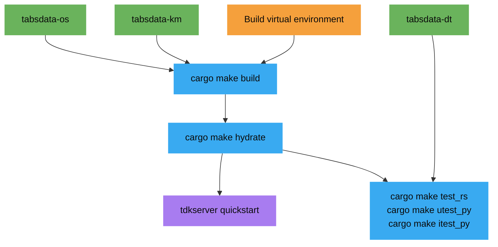

<!--
Copyright 2026 Tabsdata Inc.
-->

<div align="center">
    
    
</div>

# Developing Tabsdata

This guide takes you from a clean machine to a tabsdata built from source: you build it, run it,
test it and package it. It covers macOS, Linux (Ubuntu) and Windows.

The steps were verified on macOS (Apple Silicon), Ubuntu 24.04 (x86_64) and Windows 11 (x86_64).
Other recent versions of these systems should work too.

## Contents

- [How the pieces fit](#how-the-pieces-fit)
- [1. Install the system software](#1-install-the-system-software)
- [2. Clone the repositories](#2-clone-the-repositories)
- [3. Create the build environment](#3-create-the-build-environment)
- [4. Install tdd](#4-install-tdd)
- [5. Prepare the toolchain](#5-prepare-the-toolchain)
- [6. Build and hydrate](#6-build-and-hydrate)
- [7. Run tabsdata](#7-run-tabsdata)
- [8. Run the tests](#8-run-the-tests)
- [9. Build distributables](#9-build-distributables)
- [10. Find your way around the tasks](#10-find-your-way-around-the-tasks)
- [11. Set up your IDE](#11-set-up-your-ide)
- [12. Troubleshooting](#12-troubleshooting)

## How the pieces fit

Tabsdata is built from three repositories, checked out side by side:

| Repository | Clone it into | What it holds |
|---|---|---|
| [tabsdata](https://github.com/tabsdata/tabsdata) | `tabsdata-os` | Execution components: server, connectors, client, API and SDK (`tdk` and `tdkserver`) |
| [tabsdata-kubernetes](https://github.com/tabsdata/tabsdata-kubernetes) | `tabsdata-km` | Orchestration components: native-process pods (`km`) |
| [tabsdata-devtools](https://github.com/tabsdata/tabsdata-devtools) | `tabsdata-dt` | Developer tools: setup, build and test (`tdd`) |

The folder names matter. The repositories contain symbolic links into each other, and the build
finds them by those names. Clone each one into the folder this table gives, even though the
repository names differ, keep those folder names, and keep the three folders side by side under
the same parent folder.



Every build and test step is a [cargo-make](https://github.com/sagiegurari/cargo-make) task that
you run from `tabsdata-os`. The **build** task, `cargo make build`, also builds **kminus** in
`tabsdata-km`, and the **hydrate** task, `cargo make hydrate`, installs your build into a Python
virtual environment, so that `tdk`, `tdkserver` and the Python packages run from your sources.

> [!NOTE]
> The open-source edition runs only the function you trigger. Running every function downstream
> of a trigger in one execution plan is a feature of the enterprise edition.

## 1. Install the system software

Install everything in this section before you build. The test tools (***Docker***, the
***AWS CLI***, ***OpenTofu***, ***dig***, ***OpenSSL*** and the ***SQL Server ODBC driver***) are needed because the tests start
emulated cloud services and databases in containers.

| Tool | Version | Used for |
|---|---|---|
| AWS CLI | Any recent | Emulated cloud services the tests use |
| C/C++ toolchain | macOS: Xcode Command Line Tools<br>Linux: `build-essential`, clang<br>Windows: Visual Studio Build Tools | Native dependencies of the Rust build |
| dig | Any recent | Emulated cloud services the tests use |
| Docker | macOS: Docker Desktop<br>Linux: Docker Engine<br>Windows: Docker Desktop | Systems the tests run against |
| Git | Any recent | Cloning the repositories |
| Go | Any<br>The build downloads the exact version it needs | kminus |
| LLVM (`clang-cl`) | Any recent<br>Only on macOS, Linux | Cross-platform builds<br>Checked by `cargo make permit` |
| Microsoft ODBC Driver 18 for SQL Server | 18 | SQL Server tests |
| OpenSSL | Any recent | Emulated cloud services the tests use |
| OpenTofu | Any recent | Emulated cloud services the tests use |
| Rust (rustup) | 1.99.1 or newer | Server<br>kminus |
| uv | Any recent | Python 3.12.13<br>Virtual environments |
| zig | Any recent | Cross-platform builds<br>Checked by `cargo make permit` |

The commands below are a suggested way to install each tool, and are most useful when you are
setting up a machine for the first time. If you already have some of these tools, or prefer to
install them another way (a different package manager, an official installer or a version
manager), keep what you have: tabsdata makes few assumptions about how a tool was installed, as
long as it meets the version in the table and is on your `PATH`.

### macOS

Install the **Xcode Command Line Tools** to get a C/C++ toolchain:

```bash
xcode-select --install
```

Install [Homebrew](https://brew.sh) if you don't have it, then the tools:

```bash
brew install git uv go zig llvm awscli opentofu openssl@3
```

Install **Docker Desktop**, then start it once so that its command-line tools are installed:

```bash
brew install --cask docker-desktop
```

Install the SQL Server ODBC driver from Microsoft's **Homebrew** tap, accepting its license:

```bash
brew tap microsoft/mssql-release https://github.com/Microsoft/homebrew-mssql-release
```

```bash
HOMEBREW_ACCEPT_EULA=Y brew install msodbcsql18
```

Install Rust 1.99.1 with **rustup**:

```bash
curl --proto '=https' --tlsv1.2 -sSf https://sh.rustup.rs | sh -s -- -y --default-toolchain 1.99.1
```

Open a new terminal so that `cargo` is on your `PATH`.

### Linux (Ubuntu)

These commands are for x86_64. On arm64, use the `arm64` and `aarch64` archives of **Go**, **zig** and the
**AWS CLI** instead.

Install the C/C++ toolchain, **LLVM** and the command-line tools the build and the tests use:

```bash
sudo apt-get update && sudo apt-get install -y build-essential pkg-config libssl-dev zlib1g-dev clang libclang-dev llvm clang-tools dnsutils unzip curl git tzdata
```

Install **uv**:

```bash
curl -LsSf https://astral.sh/uv/install.sh | sh
```

Install **Go** from the official archive:

```bash
curl -fsSL https://go.dev/dl/go1.26.11.linux-amd64.tar.gz -o /tmp/go.tar.gz && sudo rm -rf /usr/local/go && sudo tar -C /usr/local -xzf /tmp/go.tar.gz
```

Install **zig** from the official archive:

```bash
curl -fsSL https://ziglang.org/download/0.14.1/zig-x86_64-linux-0.14.1.tar.xz -o /tmp/zig.tar.xz && sudo rm -rf /opt/zig && sudo mkdir -p /opt/zig && sudo tar -C /opt/zig --strip-components=1 -xJf /tmp/zig.tar.xz
```

Install the **AWS CLI** with its official installer:

```bash
curl -fsSL https://awscli.amazonaws.com/awscli-exe-linux-x86_64.zip -o /tmp/awscliv2.zip && unzip -q -o /tmp/awscliv2.zip -d /tmp && sudo /tmp/aws/install --update
```

Install **OpenTofu** from its Debian repository:

```bash
curl -fsSL https://get.opentofu.org/install-opentofu.sh -o /tmp/install-opentofu.sh && sh /tmp/install-opentofu.sh --install-method deb
```

Install the SQL Server ODBC driver from Microsoft's repository, accepting its license:

```bash
curl -fsSL -O https://packages.microsoft.com/config/ubuntu/$(grep VERSION_ID /etc/os-release | cut -d '"' -f 2)/packages-microsoft-prod.deb && sudo dpkg -i packages-microsoft-prod.deb && rm packages-microsoft-prod.deb
```

```bash
sudo apt-get update && sudo ACCEPT_EULA=Y apt-get install -y msodbcsql18 unixodbc-dev
```

Install **Docker Engine** by following [Docker's guide for Ubuntu](https://docs.docker.com/engine/install/ubuntu/),
then add yourself to the `docker` group so that the tests can run containers without `sudo`:

```bash
sudo usermod -aG docker "$USER"
```

Install Rust 1.99.1 with **rustup**:

```bash
curl --proto '=https' --tlsv1.2 -sSf https://sh.rustup.rs | sh -s -- -y --default-toolchain 1.99.1
```

Add **Go**, **zig**, **LLVM** and **Cargo** to your `PATH` in `~/.bashrc`, then open a new terminal (log out and
back in for the `docker` group to apply):

```bash
echo 'export PATH="/usr/local/go/bin:$HOME/go/bin:/opt/zig:$(llvm-config --bindir):$HOME/.cargo/bin:$PATH"' >> ~/.bashrc
```

### Windows

Run every command in this guide in **PowerShell 7**, started as Administrator. Other shells may work,
but only **PowerShell 7** is verified.

Install **PowerShell 7** itself from **Windows PowerShell**, if you don't have it:

```powershell
winget install --exact --id Microsoft.PowerShell
```

Enable long paths and Developer Mode, which **Git** needs to create the symbolic links the
repositories contain:

```powershell
New-ItemProperty -Path "HKLM:\SYSTEM\CurrentControlSet\Control\FileSystem" -Name LongPathsEnabled -Value 1 -PropertyType DWORD -Force
```

```powershell
New-ItemProperty -Path "HKLM:\SOFTWARE\Microsoft\Windows\CurrentVersion\AppModelUnlock" -Name AllowDevelopmentWithoutDevLicense -Value 1 -PropertyType DWORD -Force
```

Allow **PowerShell** to run local scripts, such as the virtual environment's activation script:

```powershell
Set-ExecutionPolicy -Scope CurrentUser RemoteSigned
```

Set `HOME`, which the build reads on every platform:

```powershell
[Environment]::SetEnvironmentVariable("HOME", $env:USERPROFILE, "User")
```

Install the **Visual Studio Build Tools** with the C++ workload:

```powershell
winget install --exact --id Microsoft.VisualStudio.2022.BuildTools --override "--quiet --wait --add Microsoft.VisualStudio.Workload.VCTools --includeRecommended"
```

Install **Git**, **uv**, **Go**, **Docker Desktop**, the **AWS CLI**, **OpenTofu**, **OpenSSL** and **Chocolatey**:

```powershell
winget install --exact --id Git.Git
```

```powershell
winget install --exact --id astral-sh.uv
```

```powershell
winget install --exact --id GoLang.Go
```

```powershell
winget install --exact --id Docker.DockerDesktop
```

```powershell
winget install --exact --id Amazon.AWSCLI
```

```powershell
winget install --exact --id OpenTofu.Tofu
```

```powershell
winget install --exact --id ShiningLight.OpenSSL.Light
```

```powershell
winget install --exact --id Chocolatey.Chocolatey
```

Install **zig** and `dig` with **Chocolatey**:

```powershell
choco install zig bind-toolsonly --yes
```

Install the SQL Server ODBC driver:

```powershell
winget install --exact --id Microsoft.msodbcsql.18
```

Install **rustup**, then Rust 1.99.1:

```powershell
winget install --exact --id Rustlang.Rustup
```

```powershell
rustup toolchain install 1.99.1
```

```powershell
rustup default 1.99.1
```

Configure **Git** to create symbolic links and accept long paths, before you clone:

```powershell
git config --global core.symlinks true
```

```powershell
git config --global core.longpaths true
```

Restart the computer so that every change applies, then start **Docker Desktop** once.

### Open files, on macOS and Linux

A local instance runs on **kminus**, whose processes keep many files open at once. On macOS and
Linux, **tdkserver** refuses to start a local instance from a shell that may open fewer than
65535 files, and **kminus** pods started with a lower limit fail with "Too many open files".

None of this is needed on Windows. Windows handles processes and files differently: it sets no
per-process limit like this one on open files, so **kminus** runs there without any change.

Raise the limit system-wide, so that it applies to every process, whether a terminal, an IDE or a
service starts it, then restart the computer.

macOS, where a launch daemon sets the limit at every boot:

```bash
sudo tee /Library/LaunchDaemons/limit.maxfiles.plist > /dev/null <<'EOF'
<?xml version="1.0" encoding="UTF-8"?>
<!DOCTYPE plist PUBLIC "-//Apple//DTD PLIST 1.0//EN" "http://www.apple.com/DTDs/PropertyList-1.0.dtd">
<plist version="1.0">
<dict>
  <key>Label</key>
  <string>limit.maxfiles</string>
  <key>ProgramArguments</key>
  <array>
    <string>launchctl</string>
    <string>limit</string>
    <string>maxfiles</string>
    <string>65535</string>
    <string>524288</string>
  </array>
  <key>RunAtLoad</key>
  <true/>
</dict>
</plist>
EOF
```

```bash
sudo chown root:wheel /Library/LaunchDaemons/limit.maxfiles.plist
```

Linux, where the login sessions read `/etc/security/limits.conf` and the services read the
**systemd** defaults:

```bash
printf '* soft nofile 65535\n* hard nofile 524288\n' | sudo tee -a /etc/security/limits.conf
```

```bash
sudo mkdir -p /etc/systemd/system.conf.d /etc/systemd/user.conf.d
```

```bash
printf '[Manager]\nDefaultLimitNOFILE=65535:524288\n' | sudo tee /etc/systemd/system.conf.d/limits.conf /etc/systemd/user.conf.d/limits.conf
```

After the restart, open a terminal and check that it prints 65535:

```bash
ulimit -n
```

If you'd rather not change the whole system, raise the limit in your shell profile instead. It
then applies only to what you start from a terminal.

macOS:

```bash
echo 'ulimit -n 65535' >> ~/.zshrc
```

Linux:

```bash
echo 'ulimit -n 65535' >> ~/.bashrc
```

## 2. Clone the repositories

Create a parent folder and clone the three repositories into it, each under the name the build
expects.

macOS and Linux:

```bash
mkdir -p ~/tabsdata-src && cd ~/tabsdata-src
```

```bash
git clone https://github.com/tabsdata/tabsdata.git tabsdata-os
```

```bash
git clone https://github.com/tabsdata/tabsdata-kubernetes.git tabsdata-km
```

```bash
git clone https://github.com/tabsdata/tabsdata-devtools.git tabsdata-dt
```

Windows (keep the parent folder short, to stay within Windows path limits):

```powershell
New-Item -ItemType Directory -Force C:\tabsdata-src; Set-Location C:\tabsdata-src
```

```powershell
git clone https://github.com/tabsdata/tabsdata.git tabsdata-os
```

```powershell
git clone https://github.com/tabsdata/tabsdata-kubernetes.git tabsdata-km
```

```powershell
git clone https://github.com/tabsdata/tabsdata-devtools.git tabsdata-dt
```

## 3. Create the build environment

Every task runs inside a Python virtual environment on Python 3.12.13. The environment also holds
the build's own tools: **maturin**, **pytest**, **ruff**, and `tabsdata-toolkit`, which every **cargo-make** task
and every local tabsdata instance need.

Create the environment in the parent folder.

macOS and Linux:

```bash
cd ~/tabsdata-src && uv venv --seed --python 3.12.13 venv
```

```bash
source ~/tabsdata-src/venv/bin/activate
```

Windows:

```powershell
Set-Location C:\tabsdata-src; uv venv --seed --python 3.12.13 venv
```

```powershell
C:\tabsdata-src\venv\Scripts\Activate.ps1
```

Activate the environment in every terminal you build, test or run tabsdata from.

Install the development requirements, pinned to the versions the project locks. The commands from
here on are the same on every platform; run them from `tabsdata-os`:

```bash
cd tabsdata-os
```

```bash
uv pip install -c variant/resources/lock/tabsdata-requirements-dev.txt -r requirements-dev.txt
```

Install **cargo-make**, which runs every task:

```bash
cargo install --locked cargo-make
```

Install `tabsdata-toolkit`:

```bash
cargo make setup
```

## 4. Install tdd

The developer tool `tdd` creates the databases and storage the tests run against. Install it from
`tabsdata-dt`:

```bash
cd ../tabsdata-dt
```

```bash
cargo make install
```

```bash
cd ../tabsdata-os
```

Load `tdd` into your shell, and add the same line to your shell profile (`~/.zshrc`, `~/.bashrc`
or the file `$PROFILE` names in **PowerShell**) so that every new terminal has it.

macOS and Linux:

```bash
source ~/.tdd/tdd-source.sh
```

Windows:

```powershell
. ~/.tdd/tdd-source.ps1
```

## 5. Prepare the toolchain

The **permit** task checks your Rust and Python versions, **zig** and **LLVM**, adds the Rust components and
targets the build uses, installs the **Cargo** tools the tasks need (**cargo-nextest**, **mdbook** and others)
and caches the PostgreSQL binaries that every build embeds:

```bash
cargo make permit
```

It always installs the latest version of each **Cargo** tool, so run it again from time to time to
stay current. The first run takes about 10 to 15 minutes.

## 6. Build and hydrate

Build the Rust workspace, the Python native libraries and **kminus**:

```bash
cargo make build
```

Install your build into the virtual environment, as editable packages, so that Python code changes
take effect without reinstalling:

```bash
cargo make hydrate
```

From now on, `tdk`, `tdkserver` and **kminus** run from your sources. After a Rust change, run
`cargo make build` again; the environment picks up the new binaries.

A first build takes about 8 minutes on a recent Apple Silicon laptop and needs about 15 GB of disk;
later builds are incremental.

### Build profiles

By default, the build uses the `dev` profile, which suits daily development. Choose another
profile with the `profile` environment variable:

| Profile | Build time | Disk use | What it is |
|---|---|---|---|
| `dev` (default) | Fastest, incremental | Largest | Unoptimized, with debug information, built into `target/debug` |
| `integration` | Medium | Medium | A balance between build time and size |
| `assembly` | Slowest | Smallest | Fully optimized for size; used for distributables |

macOS and Linux:

```bash
profile=integration cargo make build
```

Windows:

```powershell
$env:profile = "integration"; cargo make build; Remove-Item Env:profile
```

### Speed up builds with sccache (optional)

The compiler cache **[sccache](https://github.com/mozilla/sccache)** keeps compiled code, so that
rebuilding after a clean, a branch switch or in a second checkout reuses earlier work. With the incremental `dev` profile it
mostly speeds up the third-party dependencies.

Install it.

macOS:

```bash
brew install sccache
```

Linux:

```bash
cargo install --locked sccache
```

Windows:

```powershell
choco install sccache --yes
```

Enable it for your builds by setting two variables in your shell profile. Give the cache at least
33 GB; up to 100 GB performs better.

macOS and Linux:

```bash
export RUSTC_WRAPPER=sccache SCCACHE_CACHE_SIZE=50G
```

Windows:

```powershell
[Environment]::SetEnvironmentVariable("RUSTC_WRAPPER", "sccache", "User"); [Environment]::SetEnvironmentVariable("SCCACHE_CACHE_SIZE", "50G", "User")
```

Check that it is used after a build:

```bash
sccache --show-stats
```

## 7. Run tabsdata

Tell `tdkserver` to run instances from your build. In `linked` mode, each instance uses your
virtual environment directly; in `local` mode, each instance gets a separate environment built
from it.

macOS and Linux:

```bash
export TD_KUBE_UV_MODE=linked
```

Windows:

```powershell
$env:TD_KUBE_UV_MODE = "linked"
```

> [!IMPORTANT]
> Without `TD_KUBE_UV_MODE`, an instance installs the released tabsdata from PyPI instead of your
> build. Add it to your shell profile to avoid this.

Create and start a local instance:

```bash
tdkserver quickstart
```

Log in with the default administrator:

```bash
tdk login --server http://127.0.0.1:2457 --user admin --password tabsdata
```

Try the bundled example, which needs no external system. Extract it into a new folder:

```bash
tdk examples extract --name quickstart-dev --dir quickstart-dev
```

```bash
cd quickstart-dev
```

Follow the commands in its `README.txt`. In the open-source edition you trigger each of its three
functions in turn.

Stop the instance when you're done, and move it to the trash to remove it:

```bash
tdkserver stop
```

```bash
tdkserver trash
```

Trashed instances stay in `~/.tabsdata/trash` (`$HOME\.tabsdata\trash` on Windows); delete its contents to reclaim the disk space.

## 8. Run the tests

The tests need a running set of systems (PostgreSQL, MySQL, object storage emulators and more),
which `tdd` runs in **Docker**, and credentials to reach them.

### Credentials

The developer tool `tdd` encrypts what it stores about each system with a key you choose. Set it,
with at least 12 characters, and keep it the same for as long as you keep your systems:

macOS and Linux:

```bash
export _TDD_CRYPTO_KEY='a-long-key-of-your-own'
```

Windows:

```powershell
$env:_TDD_CRYPTO_KEY = 'a-long-key-of-your-own'
```

Tell the tasks not to look for credentials in **1Password**, which only the Tabsdata team uses.

macOS and Linux:

```bash
export TD_SKIP_SECRETS_LOAD=true
```

Windows:

```powershell
$env:TD_SKIP_SECRETS_LOAD = "true"
```

The local systems need nothing else. The cloud systems read their credentials from environment
variables when they are created. Set the ones for the providers you use:

| Provider | Variables |
|---|---|
| Amazon S3 | `S3__BUCKET`<br>`S3__REGION`<br>`S3__ACCESS_KEY`<br>`S3__SECRET_KEY`<br>`S3__SYS_PATH` |
| Azure Blob Storage | `AZ__CONTAINER`<br>`AZ__ACCOUNT_NAME`<br>`AZ__ACCOUNT_KEY`<br>`AZ__SYS_PATH` |
| BigQuery | `BIGQUERY__PROJECT`<br>`BIGQUERY__BUCKET`<br>`BIGQUERY__SERVICE_ACCOUNT_KEY`<br>`BIGQUERY__SYS_PATH` |
| Databricks | `DATABRICKS__HOST`<br>`DATABRICKS__TOKEN`<br>`DATABRICKS__WAREHOUSE_ID`<br>`DATABRICKS__CATALOG`<br>`DATABRICKS__VOLUME` |
| Google Cloud Storage | `GCS__BUCKET`<br>`GCS__SERVICE_ACCOUNT_KEY`<br>`GCS__HMAC_ACCESS_KEY`<br>`GCS__HMAC_SECRET_KEY`<br>`GCS__SYS_PATH` |
| Salesforce | `SALESFORCE__URL`<br>`SALESFORCE__USERNAME`<br>`SALESFORCE__PASSWORD`<br>`SALESFORCE__TOKEN` |
| Snowflake | `SNOWFLAKE__ACCOUNT`<br>`SNOWFLAKE__USERNAME`<br>`SNOWFLAKE__PAT`<br>`SNOWFLAKE__DATABASE`<br>`SNOWFLAKE__WAREHOUSE` |

Each `*__SYS_PATH` variable is the prefix inside the bucket or container under which the tests
write their data.
A good way to keep these variables is a file of your own, outside the repositories, that you load
before running the tests (`source` it in **bash** or **zsh**, dot-source it in **PowerShell**).

### Create the systems

Create the systems the tests use. Run it once; the systems keep running in **Docker** until you
destroy them:

```bash
cargo make systems_create
```

It takes about 5 minutes and about 12 GB of **Docker** images and volumes. Cloud systems whose
variables are missing fail with a message that lists what they need.

Use only the systems you have by trimming the manifests in `variant/config/pytest/`. The
`systems.yaml` manifest lists the systems, and the `domains_rs.yaml` and `domains_py.yaml`
manifests list what the Rust and Python tests create in them. Remove the entries you don't use from your copies.

### Run the test suites

Run the Rust tests:

```bash
cargo make test_rs
```

Run the Python unit tests:

```bash
cargo make utest_py
```

Run the Python integration tests:

```bash
cargo make itest_py
```

Run both Python suites, the unit tests and then the integration tests:

```bash
cargo make test_py
```

On a recent Apple Silicon laptop, the Rust tests, the Python unit tests and the Python integration
tests take about 11, 13 and 24 minutes. The Python tasks rebuild
and rehydrate first, then start their own tabsdata instances. A full test cycle needs well over
150 GB of free disk.

Run part of a Python suite with `--packages` and `--modules`. A module can be a folder, a file or a
single test:

```bash
cargo make itest_py --packages=sdk --modules=tabsdatak/sdk/test_state_lifecycle.py::test_every_kind_of_function_reads_the_state_its_last_run_left
```

Show every option of a Python test task:

```bash
cargo make utest_py --help
```

Destroy the systems when you no longer need them:

```bash
cargo make systems_destroy
```

Experienced contributors can run more checks the same way, such as `cargo make clippy`,
`cargo make fmt` and `cargo make test_go`.

## 9. Build distributables

> [!NOTE]
> For development, use the hydrated environment from step 6: it is faster, lighter and more
> reliable. Building and installing wheels is for experienced users.

Build every distributable package (wheels, with the binaries inside) with the `assembly` profile:

```bash
cargo make assembly
```

Collect the wheels into one archive, `target/wheels/tabsdata-dev-devpi.tar.gz`:

```bash
cargo make wheels --devpi
```

The wheels declare their dependencies on each other as if they came from one Python index, so
installing `tabsdata` also installs its connectors.

The most Pythonic way to use them is to publish them to a local Python index, such as
[devpi](https://devpi.net), and install `tabsdata` from it. Installing them by path into a fresh
virtual environment also works.

macOS and Linux:

```bash
mkdir -p target/wheels/devpi && tar -xzf target/wheels/tabsdata-dev-devpi.tar.gz -C target/wheels/devpi
```

```bash
uv pip install target/wheels/devpi/*.whl ./devutils/automation/tasks/python/tabsdata-toolkit
```

Windows:

```powershell
New-Item -ItemType Directory -Force target\wheels\devpi; tar -xzf target\wheels\tabsdata-dev-devpi.tar.gz -C target\wheels\devpi
```

```powershell
uv pip install (Get-ChildItem target\wheels\devpi\*.whl).FullName .\devutils\automation\tasks\python\tabsdata-toolkit
```

To run a local instance from these wheels, set `TD_KUBE_UV_MODE` to `linked` or `local`, as in
[step 7](#7-run-tabsdata).

## 10. Find your way around the tasks

List every task:

```bash
cargo make --list-all-steps
```

The tasks you use most:

| Task | What it does |
|---|---|
| `cargo make permit` | Checks and installs the toolchain |
| `cargo make build` | Builds the Rust workspace, the Python native libraries and kminus |
| `cargo make hydrate` | Installs the build into the virtual environment, as editable packages |
| `cargo make dehydrate` | Removes those packages from the virtual environment |
| `cargo make systems_create` | Creates the systems the tests run against |
| `cargo make test_rs` | Runs the Rust tests |
| `cargo make utest_py` | Runs the Python unit tests |
| `cargo make itest_py` | Runs the Python integration tests |
| `cargo make test_py` | Runs the Python unit tests, then the Python integration tests |
| `cargo make assembly` | Builds the distributable packages |
| `cargo make wheels --devpi` | Collects the wheels into one archive |
| `cargo make clean` | Removes the build outputs |

## 11. Set up your IDE

Point your IDE at the virtual environment from step 3. After `cargo make hydrate`, every package
is installed in it, so imports resolve without further setup. Mark the test folders as test source
roots so that the IDE finds the test helpers.

### PyCharm and IntelliJ IDEA

1. Set the project interpreter to `venv/bin/python` in the parent folder (`venv\Scripts\python.exe`
   on Windows).
2. Mark every `src/utest/python` and `src/itest/python` folder under `client`, `connectors/python`
   and `extensions/python` as a test sources root.

### Visual Studio Code

Select the interpreter with **Python: Select Interpreter**, then add the test folders you work on
to `.vscode/settings.json`.

macOS and Linux:

```json
{
    "python.defaultInterpreterPath": "../venv/bin/python",
    "python.analysis.extraPaths": [
        "client/platform/src/utest/python",
        "connectors/python/tabsdata-api/src/utest/python"
    ]
}
```

Windows:

```json
{
    "python.defaultInterpreterPath": "..\\venv\\Scripts\\python.exe",
    "python.analysis.extraPaths": [
        "client/platform/src/utest/python",
        "connectors/python/tabsdata-api/src/utest/python"
    ]
}
```

## 12. Troubleshooting

### All platforms

- A Rust test or Python test task stops with "Creating backend domains failed": the systems are
  missing or unhealthy. Look at the **tdd** errors above the message; for "no system named ... in the
  store", run `cargo make systems_create`.
- A Python test task stops while loading credentials from **1Password**: set `_TDD_CRYPTO_KEY` and
  `TD_SKIP_SECRETS_LOAD=true`, as in [Credentials](#credentials).

### macOS

- The SQL Server tests fail with "make sure **OpenSSL** 1.0, 1.1, or 3.0 is installed": the ODBC driver
  doesn't accept **OpenSSL** 4, which **Homebrew** installs by default. Point **Homebrew**'s `openssl` link at
  **OpenSSL** 3:

  ```bash
  ln -sfn "$(brew --prefix openssl@3)" "$(brew --prefix)/opt/openssl"
  ```

### Linux

- The **permit** task fails with `error getting credentials - err: exec: "docker-credential-desktop":
  executable file not found in $PATH`: an uninstalled **Docker Desktop** left its credential helper
  in `~/.docker/config.json`. Remove the `"credsStore": "desktop"` line from that file.

### Windows

- Microsoft Defender quarantines `tdd` programs (for example
  `~\.tdd\tdd-venvs\systems\Scripts\system.exe`) as a false positive, and `tdd` fails with
  "Operation did not complete successfully because the file contains a virus or potentially unwanted
  software". Exclude the **tdd** folder, then reinstall **tdd** (step 4):

  ```powershell
  Add-MpPreference -ExclusionPath "$HOME\.tdd"
  ```

- The **build** task fails with "Access is denied (os error 5)": a running instance holds the
  binaries you're rebuilding. List the instances, and stop each one before building:

  ```powershell
  tdkserver list
  ```

  ```powershell
  tdkserver stop --instance tabsdata
  ```
