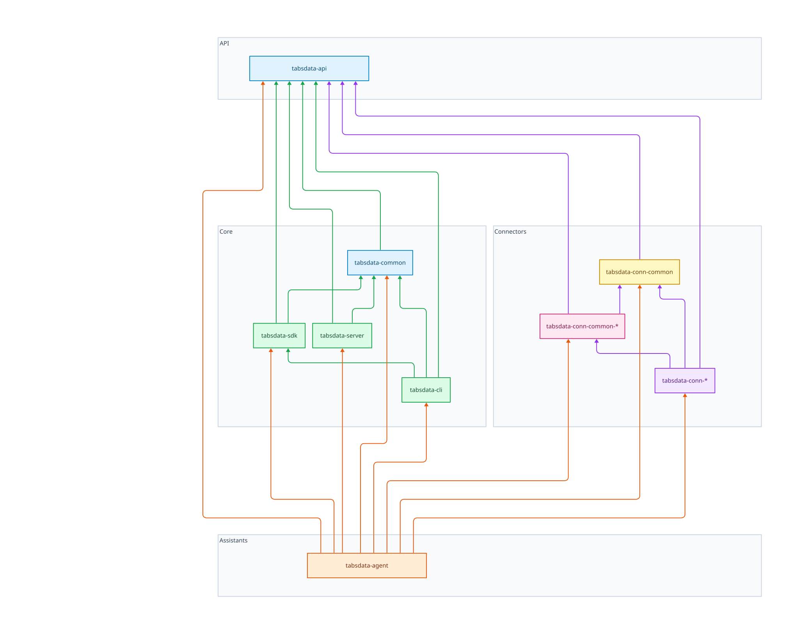

<!--
Copyright 2026 Tabsdata Inc.
-->

# Package dependency conventions

The tabsdata Python packages follow a strict layering. A package may
only depend on packages that sit **below** it in the tree — never
sideways, never up. This keeps the namespace cleanly tiered and makes
the eventual `tabsdatak` → `tabsdata` merge a mechanical rename.

## The rules

| Package | May depend on |
| ------- | ------------- |
| `tabsdata-api` | — (nothing) |
| `tabsdata-common` | `tabsdata-api` |
| `tabsdata-sdk` | `tabsdata-api`, `tabsdata-common` |
| `tabsdata-server` | `tabsdata-api`, `tabsdata-common` |
| `tabsdata-cli` | `tabsdata-api`, `tabsdata-common`, `tabsdata-sdk` |
| `tabsdata-conn-common` | `connectors/python/tabsdata-api` |
| `tabsdata-conn-common-*` | `…-api`, `…-conn-common` |
| other `tabsdata-conn-*` | `…-api`, `…-conn-common`, `…-conn-common-*` |
| `tabsdata-agent` | **any** package |

## Diagram



> Rendered from [`DEPENDENCIES.d2`](DEPENDENCIES.d2) with
> [D2](https://d2lang.com). The `align_boxes.py` step shifts the
> full-width **API** and **Assistants** frames so they span exactly the
> **Core** → **Connectors** band (D2's free layout engines cannot lock
> box positions). To regenerate after editing the source:
>
> ```sh
> d2 --layout elk DEPENDENCIES.d2 DEPENDENCIES.svg
> python3 align_boxes.py DEPENDENCIES.svg
> rsvg-convert -b white -z 2 -o DEPENDENCIES.png DEPENDENCIES.svg
> ```
>
> The `.svg` is the source of truth (crisp at any zoom); the `.png` is a
> 2× raster for contexts that don't render SVG.

## How to read it

- **Arrows point at the dependency** (`A → B` means *A depends on B*),
  so everything flows **upward** toward `tabsdata-api`, which depends
  on nothing.
- `tabsdata-api` sits above both groups because the core packages and
  the connector packages all depend on it.
- A package may use any package it can reach by following arrows; it may
  **not** depend on anything not reachable, and never on a sibling at the
  same tier.

### Legend

| Colour | Tier |
| ------ | ---- |
| 🟦 blue | foundation (`tabsdata-api`, `tabsdata-common`) |
| 🟩 green | applications (`tabsdata-sdk`, `tabsdata-server`, `tabsdata-cli`) |
| 🟨 yellow | connector base (`tabsdata-conn-common`) |
| 🟪 pink | connector families (`tabsdata-conn-common-*`) |
| 🟣 purple | leaf connectors (`tabsdata-conn-*`) |
| 🟧 orange | assistants (`tabsdata-agent`) — may depend on any package |

Arrow colours follow the source group: **green** edges leave the Core
group, **purple** edges leave the Connectors group, and **orange**
edges leave `tabsdata-agent` (which may depend on anything).
